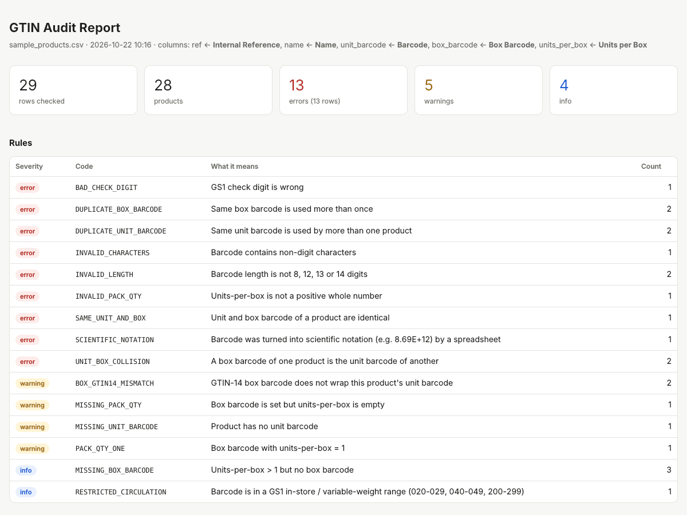

# gtin-audit

**Find barcode and packaging errors in product master data before they reach the warehouse floor.**

In distribution and food companies, product data is copied between ERPs, sales apps and spreadsheets many times. Small barcode mistakes slip in along the way: a check digit typed wrong, a leading zero dropped by Excel, a box barcode pasted into the unit field. Each one surfaces later as a failed scan, a wrong quantity booked, or a rejected delivery at a retailer.

`gtin-audit` reads a product export (CSV or Excel, e.g. from Odoo) and produces a report of every problem it finds, with the spreadsheet row number so the fix takes minutes.



## What it checks

| Severity | Code | Meaning |
|---|---|---|
| error | `BAD_CHECK_DIGIT` | GS1 mod-10 check digit is wrong |
| error | `SCIENTIFIC_NOTATION` | Barcode was turned into `8.69E+12` by a spreadsheet, digits lost |
| error | `INVALID_CHARACTERS` | Non-digit characters (e.g. letter `O` instead of zero) |
| error | `INVALID_LENGTH` | Not 8, 12, 13 or 14 digits; detects a lost leading zero |
| error | `DUPLICATE_UNIT_BARCODE` | Same unit barcode on more than one product (compared across lengths: UPC-A = EAN-13 with leading 0) |
| error | `DUPLICATE_BOX_BARCODE` | Same box barcode used more than once |
| error | `UNIT_BOX_COLLISION` | One product's box barcode is another product's unit barcode |
| error | `SAME_UNIT_AND_BOX` | Unit and box barcode identical, so scanning a box books a single unit |
| error | `INVALID_PACK_QTY` | Units-per-box is not a positive whole number |
| warning | `BOX_GTIN14_MISMATCH` | GTIN-14 box code (indicator 1-8) is built from a different item than this product's unit barcode |
| warning | `MISSING_UNIT_BARCODE` | No unit barcode |
| warning | `MISSING_PACK_QTY` | Box barcode set, but the box quantity is unknown |
| warning | `PACK_QTY_ONE` | Box barcode with units-per-box = 1 |
| warning | `ONE_CODE_MISMATCH` | Product is flagged *box = item* (one code) but its box barcode differs from the unit barcode |
| warning | `BOX_BARCODE_ON_SINGLE_UNIT` | Box barcode set, but the unit of measure is a single unit (`Units`) |
| info | `MISSING_BOX_BARCODE` | Box holds more than 1 unit but has nothing to scan (only when the file has a box barcode column) |
| info | `RESTRICTED_CIRCULATION` | In-store / variable-weight GS1 range (020-029, 040-049, 200-299) |

## Quick start

```bash
git clone https://github.com/eyildirim61/gtin-audit.git
cd gtin-audit
pip install -e ".[xlsx]"        # openpyxl is only needed for .xlsx files

python examples/generate_sample.py
gtin-audit examples/sample_products.csv
# Report: gtin_audit_report/report.html
# CSV:    gtin_audit_report/issues.csv
```

No install needed for CSV files: `PYTHONPATH=src python -m gtin_audit products.csv` works with the standard library only.

## Input

Any CSV (comma, semicolon, tab; UTF-8 or Windows-1254) or XLSX file with one row per product. Columns are detected from common English, Turkish and Odoo export headers:

| Field | Recognised headers (examples) |
|---|---|
| reference | `Internal Reference`, `default_code`, `SKU`, `Stok Kodu` |
| name | `Name`, `Product`, `Ürün Adı` |
| unit barcode | `Barcode`, `EAN`, `GTIN`, `Barkod` |
| box barcode | `Box Barcode`, `Packagings/Barcode`, `ITF14`, `Koli Barkodu` |
| units per box | `Units per Box`, `Packagings/Contained Quantity`, `Koli İçi Adet` |
| unit of measure | `Unit`, `Unit of Measure`, `uom_id`, `Birim` |
| box = item flag | `Box is Item`, `One Code`, `Same Barcode for Box`, `Tek Kod` |

**Box quantity from the unit of measure:** many ERPs (including recent Odoo versions) model a case as a unit of measure such as `Case of 12`. When there is no units-per-box column, the quantity is read from the unit of measure: `Case of 12` → 12, `Pack of 6` → 6, `Dozens` → 12, `Units` → 1. A units-per-box column, when filled, takes precedence.

**Box = item ("one code") products:** some products are deliberately sold with the same barcode on the box and the unit. Mark them with a true/false column (`True`, `1`, `Yes`, `Evet` count as true). For these products, identical unit and box barcodes are not an error and box quantity rules are skipped; a *different* box barcode is reported as `ONE_CODE_MISMATCH`.

A trailing note in parentheses is ignored when matching, so `Barcode (EAN)` is recognised as `Barcode`.

Different header? Name it explicitly:

```bash
gtin-audit export.xlsx --sheet Products --unit-barcode-col "EAN Kodu" --box-barcode-col "Koli EAN"
```

**Odoo exports with several packagings:** when a product has more than one packaging, Odoo writes the extra packagings on the following rows with the product columns empty. These rows are treated as additional packaging lines of the product above (disable with `--no-fill-down`).

## Using it in automation

`--fail-on error` makes the command exit with code 1 when errors exist, so it can guard an import pipeline or run in CI:

```bash
gtin-audit nightly_export.csv --fail-on error -q
```

## How it works

- `gtin.py`: GS1 mod-10 check digit, normalisation to GTIN-14 for comparison, GTIN-14 → item GTIN derivation
- `checks.py`: the rules above; pure functions over `Record` objects
- `loader.py`: CSV/XLSX reading, encoding detection, header aliases, Odoo fill-down
- `report.py`: CSV and self-contained HTML report (filter and search, light/dark)

Run the tests with `pytest`.

## Roadmap

- [ ] Read directly from Odoo via XML-RPC (read-only)
- [ ] GS1 company prefix check (flag barcodes outside your own prefixes)
- [ ] Suggested fixes column (e.g. restore leading zero)
- [ ] Excel report output

## Note on data

All sample data is synthetic and uses the fictional company prefix `8699999`. No real product data is included in this repository.

## License

MIT
